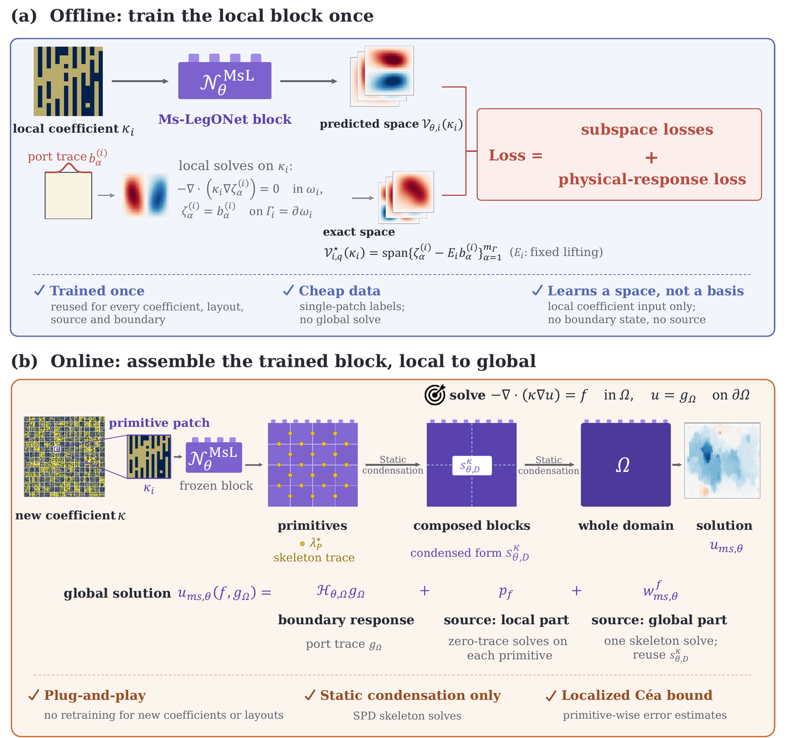
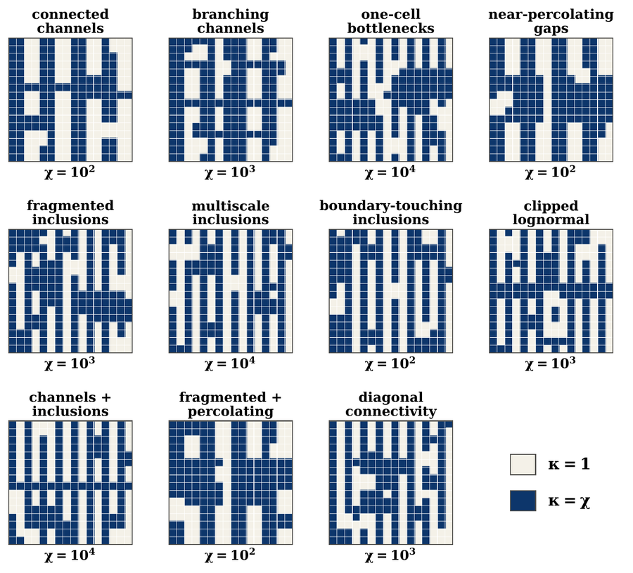
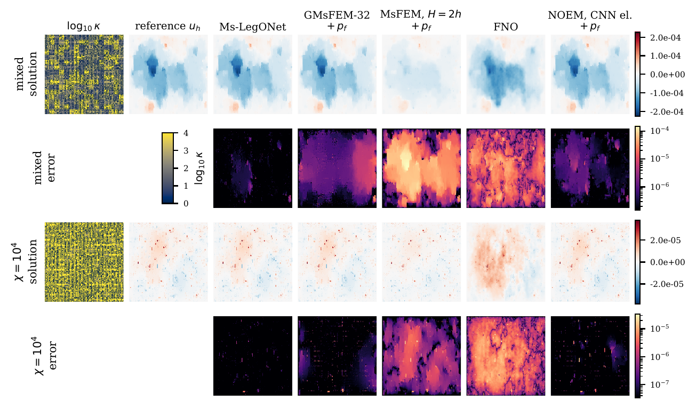

# Ms-LegONet

**Multiscale LegONet: Learning Coefficient-Dependent Local Spaces for Composable Multiscale Finite Elements with Localized Error Bounds**

Yueqi Wang\*, Cindy Xiangrui Kong\*, Guang Lin (Purdue University)
<br>\* Equal contribution

[](LICENSE)


Ms-LegONet is a plug-and-play learned block for heterogeneous elliptic problems. One network per spatial dimension is trained once on single coefficient patches and reused, without retraining, across coefficient layouts, sources, boundary data and domain sizes within the trained coefficient class. The network predicts only the coefficient-dependent **local space** of a patch. Everything after the network evaluation is deterministic linear algebra: local Galerkin solves, recursive static condensation and one global skeleton solve.

<p align="center">
  
</p>
<p align="center"><em>(a) Offline, the block is trained once on single-patch harmonic responses. (b) Online, one evaluation per primitive gives the local space; blocks are composed by static condensation up to the whole domain.</em></p>

---

## Contents

- [Highlights](#highlights)
- [Method](#method)
- [Pipeline](#pipeline)
- [2D results](#2d-results)
- [Repository structure](#repository-structure)
- [3D code](#3d-code)
- [Citation](#citation)
- [License](#license)

---

## Highlights

- **The learned object is a space, not a basis.** The network maps the local coefficient to a subspace of zero-trace fields. Ports, sources and boundary data are chosen downstream, without retraining.
- **Trained once, reused everywhere in the class.** In 2D the same network serves mosaics of up to 4,096 primitives. The training labels are harmonic responses of single patches, so no global solve enters the training data.
- **Exact composition.** Larger blocks are assembled by recursive static condensation with no network at parent scales; the composition reproduces the flat solve to round-off.
- **Localized error bound.** The global solution is a conforming Galerkin solution, and a localized Céa bound attributes the error of the learned spaces primitive by primitive.

---

## Method

### 1. Model problem

Let $\Omega\subset\mathbb{R}^d$, $d\in\{2,3\}$, and consider

```math
-\nabla\cdot(\kappa\nabla u) = f \quad \text{in } \Omega, \qquad u = g_\Omega \quad \text{on } \partial\Omega,
```

with a heterogeneous, high-contrast coefficient $0<\kappa_{\min}\le\kappa(\mathbf{x})\le\kappa_{\max}$ and contrast $\chi=\kappa_{\max}/\kappa_{\min}$. All errors are measured in the energy norm $\|v\|_{a_\kappa}=a_\kappa(v,v)^{1/2}$ with $a_\kappa(w,v)=\int_\Omega \kappa\,\nabla w\cdot\nabla v\,\mathrm{d}\mathbf{x}$. In this norm every Galerkin solution is a best approximation with constant one, independent of the contrast.

### 2. Primitive patches and conforming ports

The domain is partitioned into primitive patches $\mathcal{T}_H=\{\omega_i\}_{i=1}^{N_H}$, each an affine image of a reference patch $\widehat\omega$. A fixed, coefficient-independent port space

```math
\mathcal{B}_{\Gamma_i}=\operatorname{span}\{b^{(i)}_1,\ldots,b^{(i)}_{m_\Gamma}\}
```

lives on each patch boundary $\Gamma_i=\partial\omega_i$; shared interface coefficients make the piecewise field $H^1$-conforming. For a port trace $g$, the $\kappa_i$-harmonic extension $\mathcal{H}^{\kappa_i}_{i,h}g$ is the discrete energy minimizer on $\omega_i$ with trace $g$. Classical MsFEM and GMsFEM recompute these $m_\Gamma$ local solves for every new coefficient. Ms-LegONet replaces them with a learned space.

### 3. The learned local space

With a fixed linear lifting $E_i$ (a Coons lift in 2D), every harmonic extension splits into the lift and a zero-trace correction:

```math
\mathcal{H}^{\kappa_i}_{i,h}\,g = E_i g + \mathcal{C}^{\kappa_i}_{i,h}\,g,
\qquad
\mathcal{V}^{\star}_{i,q}(\kappa_i) := \operatorname{Range}\big(\mathcal{C}^{\kappa_i}_{i,h}\big),
\qquad q=\dim \mathcal{V}^{\star}_{i,q}.
```

The Ms-LegONet block is a map into the Grassmann manifold of $q$-dimensional subspaces of the zero-trace space $\widehat V_h^0$:

```math
\mathcal{N}^{\mathrm{MsL}}_\theta:\ \widehat\kappa_i \longmapsto \widehat{\mathcal{V}}_\theta(\widehat\kappa_i)\in\operatorname{Gr}\big(q,\widehat V_h^0\big),
\qquad
\widehat{\mathcal{V}}_\theta(\widehat\kappa_i)\approx\widehat{\mathcal{V}}^{\star}_{i,q}(\widehat\kappa_i).
```

The network reads the local coefficient only; neither a boundary trace nor a source is an input. It returns a full-rank matrix $\widetilde{\mathbf Q}_{\theta,i}\in\mathbb{R}^{n_0\times q}$, which is orthonormalized in the local energy inner product:

```math
\mathbf G_{\theta,i} = \widetilde{\mathbf Q}_{\theta,i}^{T}\mathbf A_i(\kappa_i)\,\widetilde{\mathbf Q}_{\theta,i},
\qquad
\mathbf Q_{\theta,i} = \widetilde{\mathbf Q}_{\theta,i}\,\mathbf G_{\theta,i}^{-1/2},
```

where $\mathbf A_i(\kappa_i)$ is the interior stiffness matrix of the patch.

### 4. Local Galerkin response

For any admissible port trace $g$, the learned response is $u_{\theta,i}(g)=E_ig+w_{\theta,i}(g)$, with $w_{\theta,i}(g)\in\mathcal{V}_{\theta,i}(\kappa_i)$ solving

```math
a_i^{\kappa_i}\big(E_i g + w_{\theta,i}(g),\, v_\theta\big) = 0 \qquad \forall\, v_\theta\in\mathcal{V}_{\theta,i}(\kappa_i).
```

This is the energy projection of the exact correction onto the learned space, so the local error is a best-approximation error:

```math
\big\|\mathcal{H}^{\kappa_i}_{i,h}g-u_{\theta,i}(g)\big\|_{a_i^{\kappa_i}}
=\inf_{v_\theta\in\mathcal{V}_{\theta,i}(\kappa_i)}\big\|\mathcal{C}^{\kappa_i}_{i,h}g-v_\theta\big\|_{a_i^{\kappa_i}}.
```

One network evaluation per primitive fixes the space; each trace then costs only a $q\times q$ solve.

### 5. Recursive composition by static condensation

Neighboring child blocks $D\in\mathcal{D}(P)$ are merged into a parent block $P$. The interior skeleton trace $\lambda$ minimizes the total child energy,

```math
\lambda^\star_P(g_P)=\operatorname*{arg\,min}_{\lambda\in\Lambda^{\mathrm{int}}_P}\ \frac12\sum_{D\in\mathcal{D}(P)} a^{\kappa}_D\big(\mathcal{H}_{\theta,D}\,g_D,\ \mathcal{H}_{\theta,D}\,g_D\big),
\qquad g_D=\mathcal{M}^E_{P\to D}\,g_P+\mathcal{M}^I_{P\to D}\,\lambda,
```

which is one symmetric positive-definite skeleton solve. The parent response map $\mathcal{H}_{\theta,P}$ and its condensed form are then used at the next level, up to the root block $\Omega$. The network is evaluated only at level zero, and nested elimination gives the same Schur complement as a single flat solve.

### 6. Sources and boundary data

Neither $f$ nor $g_\Omega$ enters the network. The global solution has three terms:

```math
u_{\mathrm{ms},\theta}(f,g_\Omega)=\underbrace{\mathcal{H}_{\theta,\Omega}\,g_\Omega}_{\text{boundary response}}+\underbrace{p_f}_{\text{local particular fields}}+\underbrace{w^{f}_{\mathrm{ms},\theta}}_{\text{one skeleton solve}}.
```

The particular fields $p_f=\sum_i \mathcal{E}^0_i\,p_i(f)$ are zero-trace solves on each primitive and contain no learned quantity. The correction $w^{f}_{\mathrm{ms},\theta}$ is the Galerkin solution in the zero-boundary multiscale space $V^{0}_{\mathrm{ms},\theta}$:

```math
a_\kappa\big(w^{f}_{\mathrm{ms},\theta},v\big)=\ell_f(v)-a_\kappa(p_f,v)\qquad\forall\,v\in V^{0}_{\mathrm{ms},\theta}.
```

The result is the conforming Galerkin solution in the affine space $\mathcal{H}_{\theta,\Omega}g_\Omega+p_f+V^{0}_{\mathrm{ms},\theta}$.

### 7. Localized error bound

Let $u^\star_{\mathrm{ms}}$ be the same construction with the exact local spaces, $w_i^\star$ its zero-trace correction on $\omega_i$, $\Pi_{\theta,i}$ the energy projection onto $\mathcal{V}_{\theta,i}(\kappa_i)$, and $\vartheta_{\max,i}$ the largest energy principal angle between the exact and learned spaces. Then

```math
\|u_h-u_{\mathrm{ms},\theta}\|_{a_\kappa}
\le \|u_h-u^\star_{\mathrm{ms}}\|_{a_\kappa}+\eta_{\mathrm{proj}}
\le \|u_h-u^\star_{\mathrm{ms}}\|_{a_\kappa}+\eta_{\mathrm{ang}},
```

```math
\eta_{\mathrm{proj}}=\Big(\sum_{i=1}^{N_H}\big\|(I-\Pi_{\theta,i})\,w_i^\star\big\|^2_{a_i^{\kappa_i}}\Big)^{1/2},
\qquad
\eta_{\mathrm{ang}}=\Big(\sum_{i=1}^{N_H}\sin^2\vartheta_{\max,i}\,\big\|w_i^\star\big\|^2_{a_i^{\kappa_i}}\Big)^{1/2}.
```

Both bounds are independent of the composition depth. With the complete nodal port space used in 2D, $u^\star_{\mathrm{ms}}=u_h$ and the first term vanishes. The bound requires exact local solves, so it is an analysis tool, not an a posteriori estimator.

### 8. Training loss

A training label is the set of $m_\Gamma$ zero-trace corrections of one patch, i.e. $m_\Gamma$ local solves. The singular values $\sigma_{i,r}$ of $\mathbf{Q}^{\star T}_i\mathbf A_i\mathbf Q_{\theta,i}$ are the cosines of the energy principal angles between the exact and predicted spaces. With the defects $\delta_{i,r}=1-\sigma_{i,r}^2$ the loss is

```math
\mathcal{J}_t(\theta)=\frac{1}{|\mathcal{I}_t|}\sum_{i\in\mathcal{I}_t}\Big[\beta_{\mathrm{space}}\,\mathcal{L}_{\mathrm{space},i}+\beta_{\mathrm{tail}}\,\mathcal{L}_{\mathrm{tail},i}+\beta_{\mathrm{phys}}\,\mathcal{L}_{\mathrm{phys},i}\Big],
```

where $\mathcal{L}_{\mathrm{space}}$ averages all defects, $\mathcal{L}_{\mathrm{tail}}$ averages the $q_{\mathrm{tail}}$ largest, and $\mathcal{L}_{\mathrm{phys}}$ measures the relative energy and $L^2$ errors of the local Galerkin responses on $M$ fixed probe traces, including a conditional value at risk of the largest errors. All three terms depend on the predicted space only, not on its basis.

---

## Pipeline

**Offline (once per spatial dimension)**

1. Sample coefficient patches from the coefficient class.
2. For each patch, compute the $m_\Gamma$ zero-trace corrections $\mathcal{C}^{\kappa_i}_{i,h}b^{(i)}_\alpha$ by local solves (the labels).
3. Train $\mathcal{N}^{\mathrm{MsL}}_\theta$ with the loss above; select the checkpoint on validation patches and freeze it.

**Online (for each new $\kappa$, $f$, $g_\Omega$)**

1. For each primitive, in parallel:
   1. evaluate the network once, $\widetilde{\mathbf Q}_{\theta,i}=\mathcal{N}^{\mathrm{MsL}}_\theta(\widehat\kappa_i)$, and energy-orthonormalize;
   2. compute the port responses $u_{\theta,i}(b^{(i)}_\alpha)$ and the condensed form;
   3. compute the particular field $p_i(f)$.
2. For each level of the block hierarchy, merge children into parents by a skeleton solve (static condensation).
3. Assemble $u_{\mathrm{ms},\theta}=\mathcal{H}_{\theta,\Omega}g_\Omega+p_f+w^{f}_{\mathrm{ms},\theta}$, where $w^{f}_{\mathrm{ms},\theta}$ needs one skeleton solve.

---

## 2D results

**Setup.** The reference primitive is $(0,1)^2$ with $16\times16$ bilinear $Q_1$ cells and a cellwise constant binary coefficient $\kappa\in\{1,\chi\}$, $\chi\in\{10^2,10^3,10^4\}$. The port space is the complete nodal trace space ($m_\Gamma=64$, $q=63$), so the exact-block solution equals the fine-grid solution $u_h$. Eleven coefficient families (channels, branching channels, bottlenecks, near-percolating gaps, several inclusion types, clipped lognormal and combined structures) provide $1.3\times10^5$ training patches and $2{,}200$ validation and $2{,}200$ test patches. Global tests are *mosaics* of independently drawn test patches.

<p align="center">
  
</p>
<p align="center"><em>One test patch per coefficient family. Cream: κ = 1; dark blue: κ = χ.</em></p>

**Comparison at equal unknowns.** Median relative energy / $L^2$ error (%) against $u_h$ on $16\times16$ test mosaics with a random source. Ms-LegONet uses 7,425 skeleton unknowns.

| Method | Unknowns | Mixed | $\chi=10^2$ | $\chi=10^3$ | $\chi=10^4$ |
|---|---:|---:|---:|---:|---:|
| **Ms-LegONet** | 7,425 | **4.35 / 0.48** | **1.88 / 0.11** | **3.23 / 0.43** | **8.54 / 5.78** |
| MsFEM, $H=2h$, $+p_f$ | 16,129 | 73.53 / 65.26 | 59.30 / 40.08 | 68.54 / 55.34 | 57.29 / 53.24 |
| GMsFEM-32 $+p_f$ | 7,200 | 20.00 / 8.06 | 14.38 / 3.22 | 19.03 / 6.29 | 20.58 / 16.15 |
| GMsFEM-64 $+p_f$ | 14,400 | 17.01 / 6.87 | 11.75 / 2.53 | 16.12 / 5.00 | 19.15 / 15.61 |
| NOEM, CNN element $+p_f$ | 7,425 | 10.08 / 2.12 | 2.56 / 0.21 | 5.22 / 0.96 | 20.04 / 20.15 |
| FNO | $257^2$ grid | 457.35 / 38.12 | 101.01 / 59.68 | 218.09 / 36.19 | 736.07 / 130.39 |

The full table, including the basic MsFEM and GMsFEM variants and the MIONet element of NOEM, is in the paper.

<p align="center">
  
</p>
<p align="center"><em>Mixed and χ = 10<sup>4</sup> mosaics, random source: solutions (first row) and pointwise errors |u<sub>h</sub> − ũ| on a shared log scale (second row).</em></p>

**Further observations from the paper (2D).**

- The global energy error stays at the level of the local error: 3.4%, 4.1% and 2.0% median for $f=1$, a random source and random Dirichlet data on mixed $16\times16$ mosaics, within one percentage point of the $32\times32$ mosaics.
- The effectivity index $\eta_{\mathrm{proj}}/e$ of the localized bound has median 1.002 to 1.034 on mixed mosaics and at most 1.093 on contrast-restricted ones.
- Quadtree composition of every depth reproduces the flat solve to $3\times10^{-14}$ in relative energy.
- For each new coefficient, the method is 1.6 to 2.3 times faster than a fine-grid direct solve.

---

## Repository structure

```
Ms-LegONet/
├── README.md        # this page: method, pipeline and 2D results
├── LICENSE          # MIT
├── assets/          # figures used in this README
├── 2D/              # 2D implementation (running code only)
│   └── README.md    # how to generate data, train and solve in 2D
└── 3D/              # 3D implementation, released after the paper is accepted
    └── README.md
```

The `2D/` folder contains the code needed to run the method: data generation, training and the online solver. It does not contain pretrained checkpoints, plotting scripts or error-analysis scripts. See [`2D/README.md`](2D/README.md).

---

## 3D code

The 3D study (layered media on chains $\Omega_N=(0,N)\times(0,1)^2$, reduced sine ports with $m_\Gamma=32$, and a separated low-rank representation of the learned space) is described in the paper. **The 3D code will be released in this repository after the paper is accepted.**

---

## Citation

If you use this code, please cite:

```bibtex
@misc{wang2026mslegonet,
  author = {Wang, Yueqi and Kong, Cindy Xiangrui and Lin, Guang},
  title  = {Multiscale {LegONet}: Learning Coefficient-Dependent Local Spaces for Composable Multiscale Finite Elements with Localized Error Bounds},
  year   = {2026},
  note   = {Manuscript under review}
}
```

Ms-LegONet builds on our earlier LegONet work on composable operator blocks:

- J. Zhang, Y. Wang, G. Lin. *LegONet: Plug-and-Play Structure-Preserving Neural Operator Blocks for Compositional PDE Learning.* [arXiv:2603.07882](https://arxiv.org/abs/2603.07882), 2026.
- J. Zhang, Y. Wang, G. Lin. *Geometry-aware LegONet for PDE Learning on Arbitrary Domains.* [arXiv:2607.23069](https://arxiv.org/abs/2607.23069), 2026.

---

## License

This project is released under the [MIT License](LICENSE).

For questions, please open an issue in this repository.
